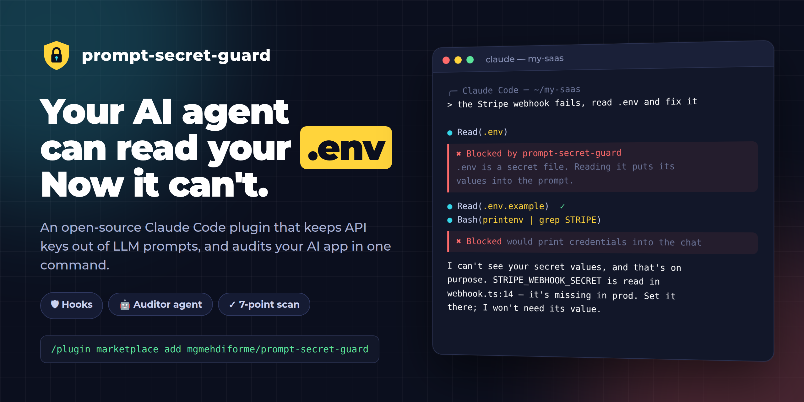
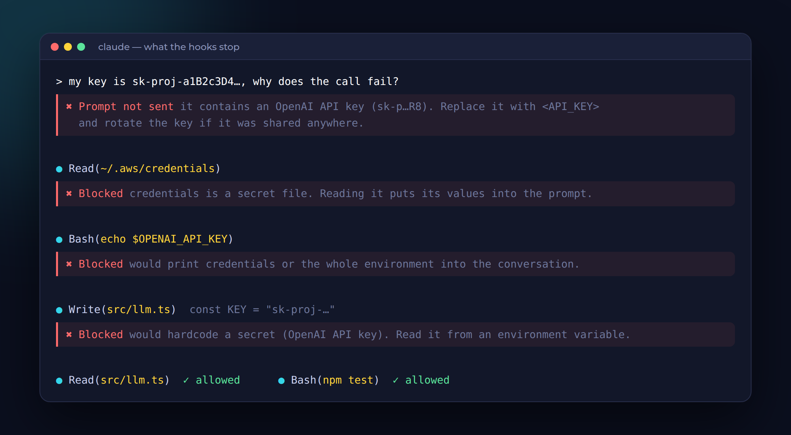
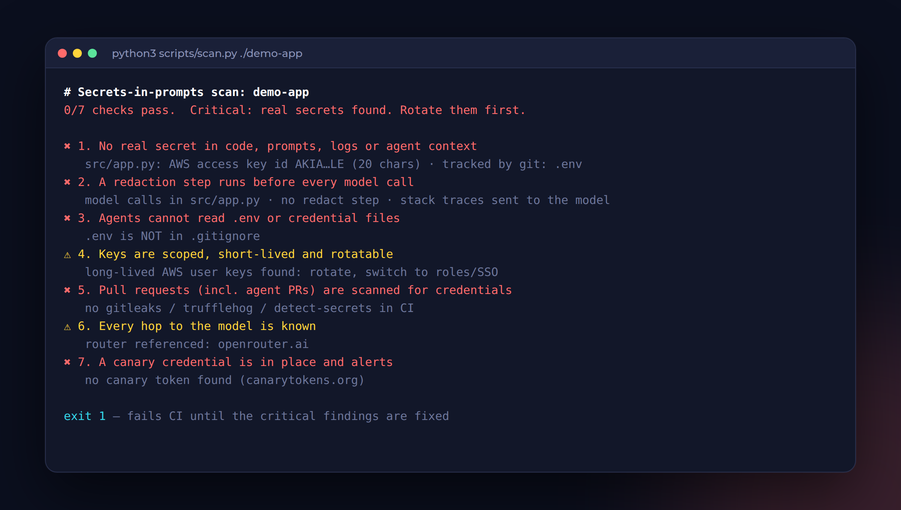

<div align="center">



# prompt-secret-guard

**Keep API keys out of LLM prompts.**<br>
A Claude Code plugin that stops your AI agent from reading or leaking secrets, and audits your AI app in one command.

[](https://github.com/mgmehdiforme/prompt-secret-guard/actions/workflows/test.yml)
[](LICENSE)
[](#-install)
[](#-install)
[](#-contributing)

[Install](#-install) · [What it blocks](#-what-it-blocks) · [Audit your app](#-audit-your-app) · [The checklist](#-the-7-point-checklist) · [FAQ](#-faq)

</div>

---

## 🔥 Why this exists

Your prompt isn't only your question. It's **everything your agent read**: files, terminal output, stack traces, logs, `.env` values. All of it goes to a model, often through routers and resellers you've never heard of.

In November 2026 this stopped being theory:

> 🧪 **Dragos** sent ~2 million prompts carrying bait AWS keys. Attackers tested some of the keys **within hours**. Data at three AI hosting providers was exposed, resellers logged prompts, and some *Zero Data Retention* requests still leaked. ([source](https://www.dragos.com/blog/ai-supply-chain-security-canary-tokens))
>
> 🤖 **Together AI** disclosed that **an AI coding agent pushed a credential to public GitHub**. It opened stored customer prompts, which held more credentials. ([source](https://techinformed.com/together-ai-links-prompt-leak-to-ai-coding-agent/))

A privacy flag only binds the first hop. **The only safe secret is one that never reaches the prompt.** This plugin makes sure of that.

## ⚡ Install

In Claude Code:

```bash
/plugin marketplace add mgmehdiforme/prompt-secret-guard
/plugin install prompt-secret-guard@prompt-secret-guard
```

That's it. The hooks are on right away. You need `python3` 3.8+ and nothing else: no pip, no npm, no API key.

## 🛡 What it blocks



| When | What happens |
|---|---|
| You paste a key into the prompt | **Prompt not sent.** You're told which key type it was (masked) and to rotate it. |
| The agent reads `.env*`, `~/.aws/credentials`, `~/.ssh/*`, `*.pem`, kube/docker/gcloud/azure configs, `*.tfstate`… | **Blocked.** The agent is told to ask for variable *names* or read `.env.example` instead. |
| The agent runs `printenv`, `env`, `echo $API_KEY`, `aws configure export-credentials`, `gh auth token`, `kubectl get secret -o yaml`… | **Blocked.** |
| The agent writes a real key into source code | **Blocked.** It's told to use an env var or a secret manager. |
| A secret shows up in a tool result anyway | The agent is **warned** not to repeat, log or commit it, and to tell you to rotate it. |
| Normal work: reading code, `npm test`, `git`, `ls .env` | ✅ **Allowed.** No noise. |

It detects high-confidence formats: AWS, Anthropic, OpenAI, GitHub, GitLab, Slack, Google, Stripe live, Hugging Face, SendGrid and Azure storage keys, private key blocks, and database URLs with passwords. Weak signals like `password=` are reported by the scanner but **never block** your work.

## 🔍 Audit your app



```bash
/prompt-leak-check                    # in Claude Code: scan + verified report + fix plan
python3 scripts/scan.py ./my-app      # standalone, no Claude needed
```

Or just ask *"does my app send secrets to the model?"* The **`prompt-leak-auditor`** agent picks it up. It's a read-only security reviewer that:

- traces what goes into **every** model call: files, env, request bodies, DB rows, stack traces, tool results
- checks prompt **logging** (app logs, Langfuse, LangSmith, Helicone, Sentry)
- searches **git history** for keys that were committed and "deleted"
- lists every **hop** to the model: base URLs, routers, resellers
- returns a 7-point report with `file:line` evidence and masked values. **It never edits your code.**

Then fix it with `/add-redaction`. It finds every model call, routes them through **one** redaction choke point (Python, TypeScript or .NET), and adds a test that proves keys get scrubbed.

### Use it in CI

`scan.py` exits `1` when it finds a real secret, so it can block a PR:

```yaml
- uses: actions/checkout@v4
- uses: actions/checkout@v4
  with: { repository: mgmehdiforme/prompt-secret-guard, path: .psg }
- run: python3 .psg/scripts/scan.py .
```

## ✅ The 7-point checklist

| # | Check | Covered by |
|---|---|---|
| 1 | No real secret ever appears in a prompt, a prompt log or an agent's context | hooks · scanner · agent |
| 2 | A redaction step runs before every model call | scanner · `/add-redaction` |
| 3 | Your agent can't read `.env` or cloud credential files | **hooks** · scanner |
| 4 | Keys are scoped to one job, short-lived, rotatable in minutes | scanner (flags long-lived keys) · skill |
| 5 | Every PR, including your AI agent's PRs, is scanned for credentials | scanner · gitleaks recipe |
| 6 | You know every hop between your app and the model | scanner · agent |
| 7 | A canary credential is in place and someone gets the alert | scanner · canary recipe |

The `secrets-in-prompts` skill has a ready-to-paste fix for each one.

## 🧩 What's inside

```
prompt-secret-guard/
├── hooks/hooks.json              UserPromptSubmit · PreToolUse · PostToolUse
├── agents/prompt-leak-auditor.md read-only security auditor
├── skills/secrets-in-prompts/    checklist, audit method, fix recipes
├── commands/
│   ├── prompt-leak-check.md      /prompt-leak-check
│   └── add-redaction.md          /add-redaction
├── scripts/
│   ├── guard.py                  the hook logic
│   ├── scan.py                   the 7-point scanner (CI-ready)
│   └── patterns.py               secret formats + secret-file rules
└── tests/test_guard.py           22 tests, fake keys built at runtime
```

## ⚙️ Settings

| Setting | Values |
|---|---|
| `PROMPT_GUARD_MODE` env var | `block` (default) · `ask` (you approve each case) · `off` |
| `.promptguardignore` in the project root | One glob per line to allow, for example `fixtures/*.pem` |

## ❓ FAQ

**Will it get in my way?** It only fires on known secret files, env-dump commands and real key formats. Reading code, running tests and git all work normally. If it ever blocks something you need, use `ask` mode or `.promptguardignore`.

**Does it send my code anywhere?** No. It's plain local Python with no network calls and no telemetry. It never prints a full secret: values show as `AKIA…LE (20 chars)`.

**Is regex enough?** No, and we say so. Regex catches known key formats. Passwords, personal data and customer data often don't look like keys. Treat this as a strong safety net plus a checklist, not a guarantee. Rotate any key that was ever committed or sent to a model.

**Cursor / other agents?** The hooks are Claude Code-specific. `scan.py`, the checklist and the fix recipes work for any stack. The skill includes a `.cursorignore` tip.

## 🤝 Contributing

New key formats, false positives and new agent tools are all welcome:

1. Add the pattern in `scripts/patterns.py`
2. Add a case in `tests/test_guard.py`, building fake keys at runtime so the repo never contains one
3. Run `python3 tests/test_guard.py` and open a PR

## 📺 Built from an episode of *Vibe Code Rescue*

This plugin started as a YouTube episode on secrets leaking through AI prompts. **[Mehdi Golzari](https://www.linkedin.com/in/mehdigolzariofficial/)** takes AI-built apps from prototype to production. If you'd like a human to check your app, [here's how](https://www.fiverr.com/mehdigolzari/fix-secure-and-launch-your-ai-built-app-from-claude-code-cursor-or-lovable).

⭐ **If this saved you from a leaked key, star the repo** so other builders find it.

<sub>MIT licensed · Not affiliated with Anthropic, Dragos or Together AI.</sub>
